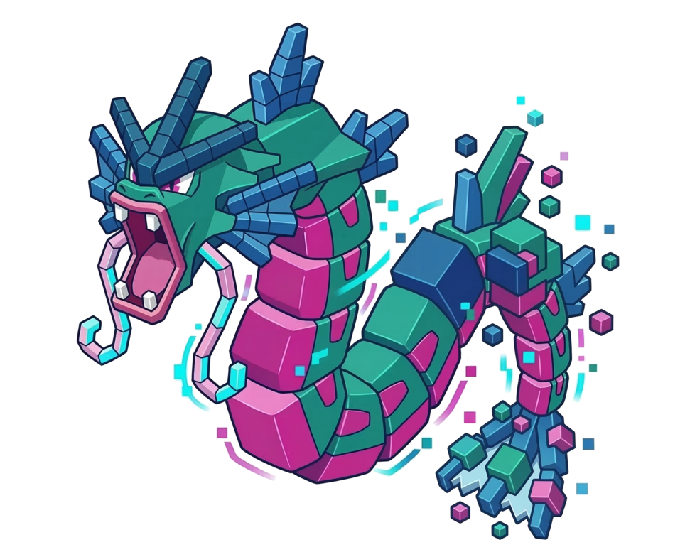
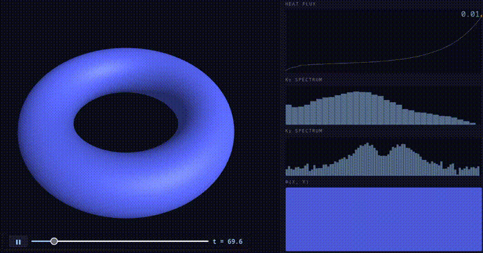

# `gyaradax`: Gyrokinetics in JAX

<p align="center">
  
</p>

`gyaradax` is a JAX code for local flux-tube gyrokinetics, based on [GKW](https://bitbucket.org/gkw/gkw/src/develop/). It is differentiable and covers electrostatic and electromagnetic (A∥, B∥) turbulence with adiabatic or kinetic electrons and a linearised Fokker-Planck collision operator, linear and nonlinear, with an optional CUDA backend and multi-GPU sharding.

**Documentation:** installation, usage, performance guide, numerics and verification are in [`docs/`](docs/index.md) (build with `pip install -e ".[docs]" && sphinx-build docs docs/_build`). The [paper](https://arxiv.org/abs/2604.06085) describes the code and its validation.

<p align="center">
  
</p>

## Quick start

```bash
pip install -e ".[cuda13]"                            # JAX with CUDA 13 (pip install -e . for CPU)
gyaradax run configs/iteration_13.yaml --device 0     # nonlinear adiabatic ITG
gyaradax run outputs_adiabatic_iteration_13           # resume it
gyaradax info                                         # devices and backends
```

```python
import gyaradax as gyx

df, geometry, params, state, pre = gyx.gk_from_config("configs/iteration_13.yaml")
df, phi, fluxes, state = gyx.gk_run(df, geometry, params, state, 400, pre=pre)
```

The optional CUDA kernels are built from `gyaradax/backends/cuda_kernels/` with CMake; see the installation page of the docs.

## Tests

```bash
python -m pytest tests/ -x -q
```

Most tests compare against GKW reference runs on Hugging Face ([gerkone/gyaradax-tests](https://huggingface.co/datasets/gerkone/gyaradax-tests)) and skip unless downloaded: `pip install -e ".[test]"`, then add `--download-test-data`. The files go to `$GYARADAX_TEST_DATA` (default `~/.cache/gyaradax/test_data`). [CONTRIBUTING.md](CONTRIBUTING.md) covers the tests, how to show that a change keeps long runs unchanged, and the open work.

## Development

`gyaradax` was written with coding agents under human supervision; [PROMPT.md](docs/PROMPT.md) is the prompt of the first working version, and the docs describe the validation loop used for every change since.

## Citing

```bibtex
@misc{galletti2026gyaradax,
  title         = {gyaradax: Local Gyrokinetics JAX Code},
  author        = {Gianluca Galletti and Eric Volkmann and Johannes Brandstetter},
  year          = {2026},
  eprint        = {2604.06085},
  archivePrefix = {arXiv},
  primaryClass  = {physics.plasm-ph},
  url           = {https://arxiv.org/abs/2604.06085},
}
```
