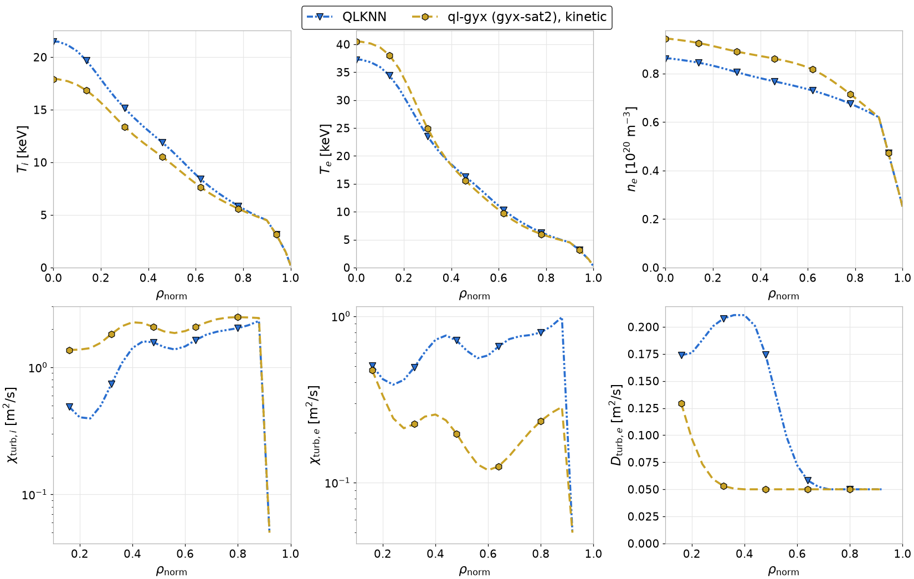

# Quasilinear fluxes

A nonlinear run gives the turbulent fluxes directly, but it takes hours. A quasilinear model estimates them from a linear run, which takes seconds to minutes. It rests on two observations from nonlinear simulations:

- in many regimes the turbulence keeps the phase relations of the linear modes. The ratio of the flux to the fluctuation intensity of a mode, its *quasilinear weight*, is then close to the linear one.
- the saturated intensity of each $k_y$ can be estimated from linear quantities: the growth rate, the perpendicular wavenumber of the mode and, in the more detailed rules, the shape of the spectrum.

Linear theory gives the weight but not the amplitude, since a linear mode grows without bound. A *saturation rule* supplies the amplitude. Its free constant $C$ is fitted to nonlinear runs.

## What `gyx` computes

{func}`~gyaradax.quasilinear.point_eval.ql_at_point` evaluates the model at one operating point (one set of gradients and geometry):

1. **Linear run.** A linear initial-value run from a small perturbation, in blocks of 100 steps. It stops when the growth rates of all $k_y$ change by less than $10^{-4} + 10^{-3}\max|\gamma|$ between blocks, two blocks in a row, after at least 200 and at most `n_steps_linear` steps. Each $k_y$ is then dominated by its fastest-growing mode. With kinetic electrons the time step is capped at the linear CFL estimate. `df0` starts the run from a given distribution instead of the perturbation, as `ql-gyx` does between transport calls.
2. **Mode quantities.** From the final distribution and potential: the growth rate $\gamma(k_y)$, the linear flux $\Gamma(k_x, k_y)$ of each mode (the same flux integrals as in a nonlinear run) and the potential intensity $|\phi|^2(s, k_x, k_y)$ along the field line.
3. **Weight.** $W(k_y) = \sum_{k_x} \Gamma / \sum_{k_x} |\phi|^2$, the flux per unit intensity, with both sums over the $\theta_0 = 0$ chain (the $k_x$ modes linked to $k_x = 0$, {func}`~gyaradax.quasilinear.rules.kx_chain0`). The mode amplitude cancels, so $W$ does not depend on how far the mode has grown.
4. **Wavenumber.** The mode average $\langle k_\perp^2 \rangle(k_y) = \int \sum_{k_x} k_\perp^2 |\phi|^2\,ds \,/ \int \sum_{k_x} |\phi|^2\,ds$, with $k_\perp^2$ from the metric. It measures how extended the mode is along the field line and radially.
5. **Saturation rule.** The rule turns $\gamma$ and $\langle k_\perp^2\rangle$ into a saturated intensity per $k_y$, multiplies it by $W$ and sums over $k_y$.

All rules gate the growth rate with $\hat\gamma = \sigma(20\gamma)\max(\gamma, 0)$. Stable modes contribute nothing, and the flux goes smoothly to zero at marginal stability, which keeps its gradient finite. The $k_y = 0$ column is left out.

```python
from gyaradax.quasilinear import calibration, ql_at_point

cal = calibration.load("auto", rule="sat2")
qi, qe, pfe = ql_at_point(
    base, geometry, (24, 8, 16, 9, 8), rule="sat2", rule_options=cal["options"],
    channel_params=calibration.channel_parameters(cal, "adiabatic"),
)
```

`base` and `geometry` are the small case of {doc}`index`. The grid tuple is $(n_{v_\parallel}, n_\mu, n_s, n_{k_x}, n_{k_y})$. The result is the ion heat flux, the electron heat flux and the electron particle flux, in GKW gyro-Bohm units like the nonlinear diagnostics.

- With adiabatic electrons there is no electron channel: `qe` repeats `qi` and `pfe` is zero.
- With kinetic electrons each channel has its own weight $W$ and its own calibration, on one shared intensity.
- Electromagnetic runs add the magnetic flutter flux of $A_\parallel$ to the weight.

The heat fluxes are clipped to [0, 1000], the particle flux to [-1000, 1000], and fluxes below $10^{-8}$ are set to zero.

## Saturation rules

| rule | flux | idea |
|---|---|---|
| `canonical` | $C \sum_{k_y} W\, \hat\gamma / \langle k_\perp^2\rangle$ | mixing length: a mode saturates when its eddies turn over at its growth rate |
| `sat0` | $C \sum_{k_y} W\, k_y (\hat\gamma / \langle k_\perp^2\rangle)^2$ | Waltz mixing rule: the potential saturates at $\phi \sim \hat\gamma/\langle k_\perp^2\rangle$, the intensity is its square, and $k_y$ comes from the $E\times B$ velocity |
| `sat2` | $C \sum_{k_y} W\, I(k_y)^p$ | SAT2 ({doc}`Staebler et al. 2021 <../references>`): zonal-flow mixing couples the modes |

`sat2` first finds $k_{y,\max}$, the peak of $\hat\gamma/k_y$ at ion scales. Above it the growth rate is limited by the zonal-flow mixing rate. The intensity is

$$
I(k_y) = \frac{1}{k_{y,\max}} \frac{12}{R/L_p}
\left(\frac{\gamma_\mathrm{eff}}{k_{x,\mathrm{width}}\, k_y}\right)^2 ,
$$

with $\gamma_\mathrm{eff}$ the mixing-limited growth rate, $R/L_p$ the pressure gradient and $k_{x,\mathrm{width}}$ the radial width of the spectrum. The width comes from SAT2's model (`kx_width_model="tglf"`) or is measured from $|\phi|^2$. The fitted exponent $p$ (`flux_exponent`) is 1 in the original SAT2. The rules are plain `jax.numpy` in {mod}`gyaradax.quasilinear.rules`, whose docstrings list every option.

## Calibrations

The amplitude $C$, and for `sat2` the exponent $p$, are fitted to nonlinear runs, separately for each electron model and flux channel ($Q_i$, $Q_e$, $\Gamma_e$). The fitted values ship with the package:

```python
calibration.names()                                # bundled calibrations
cal = calibration.load("sat2_v3")                  # or "auto" with rule=..., or a JSON path
calibration.channel_parameters(cal, "kinetic")     # {"Qi": {"cn": ..., "flux_exponent": ...}, "Qe": ..., "Gamma": ...}
```

A record holds the rule, the `options` shared by every channel and the fitted `parameters` per electron model and channel. It belongs to the rule, the weights it was fitted with (the $\theta_0 = 0$ chain) and the resolution of the linear runs; refit for another one. A fit must call the rule itself: a separate implementation, such as a numpy copy with a hard gate, gives a different $C$.

## In TORAX

`ql-gyx` ({doc}`torax`) runs this model at a few radii of a TORAX simulation. The figure is [the iterhybrid example](torax.md#evolved-profiles): `sat2` with `sat2_v3`, kinetic electrons, 8 radii, restarted from the QLKNN solution at t = 3.03 s and evolved to t = 5 s, against QLKNN.



## Gradients

The rules and the linear run are differentiable. The early stop is a `lax.while_loop`, which reverse mode cannot differentiate, so set `early_stop=False` for a run of fixed length. `jax.grad` then gives for example the stiffness $\partial Q_i / \partial(R/L_T)$:

```python
def qi_of(rlt):
    p = dataclasses.replace(base, rlt=rlt)
    return ql_at_point(
        p, geometry, (24, 8, 16, 9, 8), rule="sat2", rule_options=cal["options"],
        channel_params=calibration.channel_parameters(cal, "adiabatic"), early_stop=False, n_steps_linear=400,
    )[0]

stiffness = jax.grad(qi_of)(6.9)
```

It agrees with a central difference. Reverse mode stores all 400 steps. Forward mode, `jax.jacfwd(qi_of)`, gives the same number without storing them, which allows the longer runs that converge the growth rates.

See {doc}`differentiable` for what can be differentiated and what it costs.

## Limits

- One mode per $k_y$: the run converges to the fastest-growing one, and a subdominant mode with a different weight (a TEM below an ITG, say) is missed.
  {doc}`eigenmodes` finds those.
- Near marginal stability the growth rates converge slowly, and the run may stop at `n_steps_linear` before they settle.
- Damped $k_y$ have no converged growth rate. Their rate keeps changing, so the early stop, which waits for every $k_y$, does not fire, and the rate at the end of the run enters the rule. In the example above the run goes to the full 2000 steps, and `return_diagnostics=True` reports `gamma_max` = 0.57. That rate belongs to the highest $k_y$, which {doc}`eigenmodes` finds damped.
- Nonlinear effects without a linear signature, such as the Dimits shift (linearly unstable cases with almost no flux), are outside the model.
