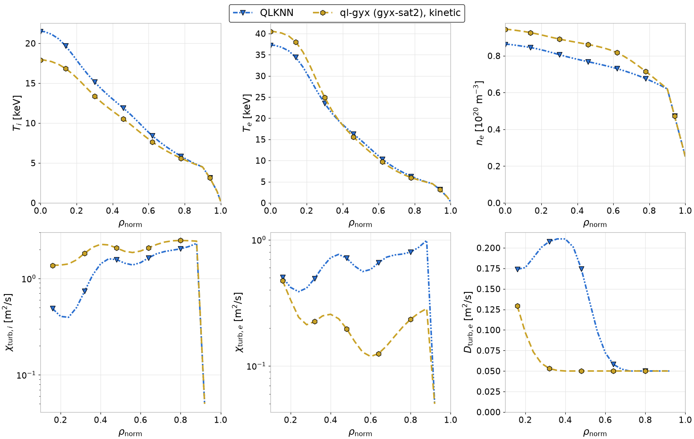

# gyaradax in TORAX

`gyaradax.transport` adds two TORAX transport models. Importing it registers them.

- **`ql-gyx`**: quasilinear. At each `rho_match` radius it runs one linear gyaradax solve
  (all ky at once, stopped when the growth rates converge), then applies a saturation rule.
- **`nl-gyx`**: nonlinear. At each `rho_match` radius it runs a nonlinear simulation and
  averages the fluxes over its last blocks, with adiabatic or kinetic electrons. This is ground
  truth for validation, not for routine transport runs.

Both interpolate the fluxes between the radii onto the TORAX grid and convert them from GKW
gyroBohm units (a factor 2 sqrt 2 from GKW's v_th = sqrt(2T/m)).

## Install

The models need TORAX 2. They register through its plugin API (`torax.transport.register_transport_model`) and reuse its quasilinear helpers, so the extra pins a minor release.

```bash
python3.12 -m venv .venv
.venv/bin/pip install -e "path/to/gyaradax[torax]"
.venv/bin/pip install "jax[cuda13]==<the installed jax version>"   # for a GPU
```

## Example: ITER hybrid with ql-gyx

`gyaradax/transport/cases/iterhybrid.py` is TORAX's `iterhybrid_predictor_corrector` example with
ql-gyx in QLKNN's place:

```python
QL = {
    "model_name": "ql-gyx",
    "rho_min": 0.15,
    "rho_max": 0.95,
    "rho_match": (0.2, 0.3, 0.4, 0.5, 0.6, 0.7, 0.8, 0.9),
    "kinetic": True,  # 32x12x18x191x32, two species
    "rule": "sat2",
    "backend": "cuda",
    "fused_linear": True,
    "n_steps_linear": 404250,  # cold first call: t = 300 at the smallest CFL step
    "warm_start": True,
    "warm_start_steps": 10000,
    "early_stop_block": 250,
    "early_stop_atol": 1e-5,
    "early_stop_rtol": 1e-5,
    "early_stop_min_steps": 2000,
    "early_stop_patience": 24,
}
```

Each radius is its own solve on one device (radius k on GPU k mod the GPU count), the GPUs in parallel and independent of each other, so the eight radii run one per GPU on an 8-GPU node. TORAX itself runs on the CPU: importing `gyaradax.transport` makes the CPU JAX's default device. The first transport call is cold and runs to t = 300; every later call starts from that radius's previous distribution, kept on its GPU, and runs at most 10000 steps. A radius whose ikxspace changes (shat crossing a choice) starts cold again, since its kx connectivity changed.

Run it as a TORAX config file, or from Python:

```bash
run_torax --config=gyaradax/transport/cases/iterhybrid.py
```

```python
import torax
from gyaradax.transport.cases import iterhybrid

history = torax.run_simulation(torax.ToraxConfig.from_dict(iterhybrid.CONFIG))
output = history.simulation_output_to_xr()
```

Any other TORAX config uses the models the same way, after `import gyaradax.transport`.

### Evolved profiles

The figure shows iterhybrid at t = 5 s with `ql-gyx` (bundled SAT2 weights, kinetic electrons, native grid, the 8 radii above) and with QLKNN as shipped by TORAX. The top row has the profiles, the bottom row the turbulent coefficients TORAX received.



The `ql-gyx` run does not start from the initial profiles. It restarts from the QLKNN solution at t = 3.03 s and evolves the last 2 s with `ql-gyx` alone. TORAX calls the transport model about three times per time step, 75 calls in this run. The first call runs every radius cold to t = 300. Every later call starts each radius from its distribution of the previous call and runs at most 10000 steps; every warm solve in this run reached that cap, so its fluxes come from a fixed continuation of the previous distribution rather than from a converged growth rate. Two radii changed ikxspace as their shat drifted (rho 0.48 and rho 0.2) and ran cold once more. All 75 calls were finite.

The two models agree outside rho 0.6. Inside it, `ql-gyx` gives a larger ion diffusivity and a smaller electron one than QLKNN, so T_i is lower (18 against 21.5 keV on axis) and T_e more peaked (40 against 37 keV). Its D_e sits on TORAX's floor outside rho 0.3, so the density peaking comes from the pinch. T_i settles within a few tenths of a second of the restart; T_e and n_e are still evolving at t = 5 s, in both runs.

To reproduce it, run the QLKNN example first, then restart `ql-gyx` from its output. The run needs one GPU per radius for the radii to run in parallel; with fewer GPUs they share them.

```python
import copy

import torax
from torax.examples import iterhybrid_predictor_corrector

from gyaradax.transport.cases import iterhybrid

ref = torax.run_simulation(torax.ToraxConfig.from_dict(iterhybrid_predictor_corrector.CONFIG))
ref.simulation_output_to_xr().to_netcdf("iterhybrid_qlknn.nc")

cfg = copy.deepcopy(iterhybrid.CONFIG)
cfg["restart"] = {"filename": "iterhybrid_qlknn.nc", "time": 3.026, "do_restart": True, "stitch": False}
cfg["transport"]["core_transport_models"]["turbulent"]["diagnostics_path"] = "calls.jsonl"
history = torax.run_simulation(torax.ToraxConfig.from_dict(cfg))
history.simulation_output_to_xr().to_netcdf("iterhybrid_ql_gyx.nc")
```

TORAX writes nothing until the run ends; `calls.jsonl` has one row per call and radius as the run goes, with the TORAX time `t`, so progress can be followed there.

## Configuration

| field | models | default | meaning |
|---|---|---|---|
| `rho_match` | both | 0.35, 0.55, 0.75, 0.875 | the radii that run gyaradax |
| `grid_preset` | both | from `kinetic` | `adiabatic` (32x8x16x85x32) or `kinetic` (32x12x18x191x32, two species) |
| `nvpar`, `nmu`, `ns`, `nkx`, `nky`, `ikxspace`, `krhomax` | both | from the preset | flux-tube grid; never below nkx 85, nky 32 |
| `backend`, `mixed_precision`, `fused_linear` | both | `jax`, true, true | `jax` keeps the call differentiable; `cuda` + `fused_linear` is the fastest |
| `linear_arith` | both | `fp64` | CUDA: `ds` runs the linear RHS in double-single arithmetic, faster on weak-FP64 GPUs such as B300 |
| `kinetic`, `em` | both | false | kinetic electrons, A_par (experimental) |
| `collisions` | both | true | linearised Fokker-Planck collisions, with frequencies from the local n_e and T_i (as `coll_nref`, `coll_tref`) and R_major (`coll_rref`) |
| `ikxspace_choices`, `ikxspace_per_shat` | both | kinetic preset: 1, 2, 3, 4, 6, 8, 12, 16; 6.53 | per radius, ikxspace is the largest choice below floor(6.53 abs(s_hat)); empty keeps the fixed `ikxspace`. Each choice adds one prebuilt topology (about 18 MB at the kinetic grid) |
| `diagnostics_path` | both | | one jsonl row per call and radius: local parameters, fluxes, steps, wall time and the TORAX time `t` of the call |
| `rule`, `rule_options` | ql | `sat2` | saturation rule (`sat2`, `canonical`, `sat0`), and its options |
| `calibration`, `cn` | ql | `auto` | calibration name or JSON path (`auto`: the rule's default in `gyaradax/quasilinear/weights/`, `sat2_v3` or `canonical_v3`), with parameters per electron model and flux channel; `cn` instead sets one amplitude for every channel |
| `n_steps_linear`, `early_stop` | ql | 2000, true | cap on RK4 steps, and stopping on converged growth rates |
| `warm_start`, `warm_start_steps` | ql | true, 1000 | start each radius from its final distribution of the previous transport call, kept on its device (cold when the ikxspace changes), and the step cap of such a warm solve |
| `n_steps_nl`, `nl_tail_blocks`, `nl_block` | nl | 30000, 12, 500 | run length and averaging window |

The local inputs at each radius are R/L_Ti, R/L_Te, R/L_n, q, s_hat, eps, T_e/T_i, n_e and T_i from
the TORAX profiles, clipped into `clip_*`. The flux tube is circular with a pure deuterium plasma:
shaping, impurities, Z_eff and a DT main ion are not modelled yet. Remaining fields (geometry and solver settings, clip boxes,
particle-transport options) are listed in `gyaradax/transport/base.py`.
